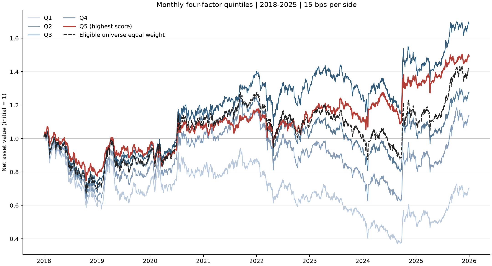

# 中证800口径四因子月度研究（v1）

v1 已冻结，后续改进见另一仓库（v2）.

**这个项目在做什么：** 用历史数据检验“按四条简单规则给股票打分，高分的股票之后是不是真的表现更好”.

**怎么做的：** 每月底给约 800 只股票（沪深300 + 中证500 的历史成分股）打分，分成五组，每组下月初买入、持有一个月，扣除手续费，并考虑涨停买不进、跌停卖不出、停牌等限制，模拟 2018–2025 年.

**结论：** 高分组（Q5）年化收益比同池合格股票的等权基准高约 0.70 个百分点，但其月度超额收益在统计上不显著（t≈-0.02）. 它主要体现为走势更平稳，而不是平均收益更高；单边手续费升到 0.3% 后优势消失. 这是一个研究练习，不是可用的交易策略.

**从哪里看起：**

1. 先看下面的净值图.
2. 再读 [report/report.pdf](report/report.pdf)（7 页）.
3. 想看代码：[notebooks/mvp_walkthrough.ipynb](notebooks/mvp_walkthrough.ipynb)（十只股票的手算小例子）.
4. 想自己运行：需联网下载数据，耗时较长，取决于网络，需耐心等待，见下方“运行”一节.



**名词小注：**

- **Q1–Q5：** 按分数从低到高分成的五组股票.
- **基准：** 所有合格股票等权持有的组合.
- **RankIC：** 分数排名与下月持有期收益排名的相关性.
- **成本 15 bps：** 每次买入或卖出，按成交额收取 0.15%.
- **涨停/跌停：** 一天内价格涨跌幅的限制，主板通常为 10%，部分板块和 ST 股票的规则不同；本回测在开盘涨停时不买、开盘跌停时不卖.

**一句话结论.** 研究范围为 2018—2025 年沪深300+中证500历史成分股（中证800口径），不是全 A 股.
主要信号来自低波动与低换手.
Q5 年化比同池等权基准高约 0.70 个百分点，但月度超额不显著.
单边成本升至 30 bps 后优势消失.
这是研究型项目，不是可交易策略.

使用 BaoStock 沪深300+中证500历史成分股（中证800口径），不是全 A 股，完成四因子、月度 RankIC、五组含成本回测和一张净值图. 回测区间为 2018—2025 年，2018 年 1 月首次建仓使用 2017 年 12 月末信号. 收益、有效样本和 IC 结果以本次运行生成的 CSV 为准.

## 本次结果

已完成 2018-01-02 至 2025-12-31 的 1942 个交易日、96 个信号月，形成 75157 个合格股票月. 各月合格股票数为 716—800. 依据：[日净值](results/tables/mvp_nav.csv)、[样本汇总](results/tables/mvp_sample_summary.csv).

| 组合 | 年化收益 | 年化波动 | Sharpe | 最大回撤 | 年化单边换手/倍 |
|---|---:|---:|---:|---:|---:|
| Q1 | -4.48% | 27.05% | -0.034 | -63.74% | 6.25 |
| Q2 | 1.71% | 23.16% | 0.189 | -48.95% | 8.40 |
| Q3 | 3.21% | 20.71% | 0.256 | -36.52% | 8.71 |
| Q4 | 7.01% | 18.57% | 0.458 | -34.30% | 8.25 |
| Q5 | 5.34% | 16.41% | 0.399 | -30.28% | 5.50 |
| 等权基准 | 4.64% | 20.52% | 0.324 | -35.03% | 0.62 |
| 多空扣费后 | 2.33% | 19.62% | 0.216 | -42.86% | 12.19 |
| 多空零费用 | 6.29% | 19.46% | 0.411 | -40.23% | 12.17 |

数值来自 [绩效表](results/tables/mvp_performance.csv) 和 [多空对比](results/tables/mvp_long_short_comparison.csv). Q5 年化收益比等权基准高 0.70 个百分点，但 Q4 高于 Q5，分层收益并非严格单调. 两个独立多空账户的年化收益相差约 3.95 个百分点，显示本设定下交易成本影响较大.

综合分数的平均 RankIC 为 0.0816，ICIR 为 0.4107，正 IC 月份占 69.47%，有效月份为 95. 四因子及综合分数的完整结果见 [IC 汇总](results/tables/mvp_ic_summary.csv). 净值图见 [mvp_nav.png](results/figures/mvp_nav.png).

## 运行

在现有 Windows 环境运行：

```powershell
Set-Location <project-directory>
python run_all.py
```

首次运行需要联网下载 BaoStock 数据；已保存的 CSV 缓存会复用，下载中断后可重新执行同一命令. 单只股票多次失败后先处理其余股票，最后补拉；仍缺数据时停止，不生成缺样本的正式回测. 缓存完整后可离线重算：

```powershell
python run_all.py --offline
```

离线模式缺少所需缓存时会报错. 迁移环境时使用 Python 3.12，按 `requirements.txt` 安装依赖后，在项目根目录运行 `python run_all.py`.

在 VS Code 中打开 [教学 Notebook](notebooks/mvp_walkthrough.ipynb)，可逐步查看四因子、十只股票手算 RankIC、调仓时点和成本示例；末尾单元读取已经生成的真实结果，无需再次联网.

正式结果生成后，运行 `python report/build_report.py` 可读取结果表并生成 `report/report.tex` 与 `report/report.pdf`. PDF 编译需要安装 XeLaTeX；仅导出可编辑源码时使用 `python report/build_report.py --tex-only`. 报告程序缺少正式输入时会停止，不使用示例数据填充结果.

下载完成后运行 `python scripts/build_manifest.py`，生成每只股票的起止日期、行数和下载时间清单 `data/mvp/manifest.csv`. 现有缓存没有单独保存 API 完成时间，清单采用文件最后写入时间，并在 `download_time_source` 中明确标为 `daily_file_mtime`. 当前缓存支持中断后复用已有文件，尚不自动追加新增交易日.

完整收尾运行 `python scripts/finalize_delivery.py`：检查结果及数据清单齐备后生成报告，并打包为 `delivery/a-share-multifactor-delivery.zip`. 使用 `--check-only` 只检查已有文件. 本地交付包含源码、Notebook、报告、结果表、派生信号和数据清单，排除原始行情缓存；`delivery/` 与 `data/` 一同排除在 Git 提交之外.

GitHub 随附汇总结果和净值图，不随附约 30 MB 的逐笔成交大表 `results/tables/mvp_trades.csv`；本地项目与交付 ZIP 包含该表. 克隆仓库后如需重新生成完整交付，应先运行数据与回测入口.

## 测试

运行 `python -m pytest -q`，默认收集 5 项 MVP 检查和 2 项未来函数反面检验，共 7 项测试. 反面检验仅用合成数据，故意把未来收益混进因子，验证 RankIC 和回测收益虚高，并验证“改动未来价格后过去信号不变”的断言能检出这种污染.

## 方法

**数据与股票池.** 交易日历覆盖 2016-12-01 至 2025-12-31，前段数据用于因子回看. 下载未复权日线及复权因子；新下载股票从首次入池信号日前 252 个交易日起保留行情，一直取到研究结束，代码排序首只保留完整窗口以维持公共日期网格. 既有日线与分块缓存继续复用，复权事件仍向前查询至 1990 年以保留历史基准. 每个信号月末查询当时的沪深 300 与中证 500 成员，合并去重，并拒绝日期晚于信号日的成员快照. 信号日期为 2017 年 12 月至 2025 年 11 月的最后一个交易日. 合格股票须在当期成员并集中、月末非 ST、交易状态正常，且四个因子均为有限值.

**四因子与综合分数.** 记 `P[t]` 为后复权收盘价，`r[t] = P[t] / P[t-1] - 1`，下标按交易日计. 因子窗口不前填缺失数据.

| 因子 | 月末计算口径 |
|---|---|
| 动量 `momentum` | `P[t-21] / P[t-252] - 1`，跳过最近 21 个交易日 |
| 反转（取负的近一月收益） `reversal` | `-(P[t] / P[t-21] - 1)` |
| 低波动（取负的波动率） `low_volatility` | 最近 60 个交易日日收益率的样本标准差取负 |
| 低换手（取负的平均换手率） `turnover` | 最近 20 个交易日日换手率的均值取负 |

四因子的方向在首次 MVP 实现中事先固定，未根据本次结果改向：动量正向、反转及波动率和换手率负向. 四因子均按数值越大越有利定向. 只做截面百分位排名，未做去极值、z-score 标准化、行业或市值中性化. 在同一合格股票池内分别计算截面百分位排名，同值取平均名次，四个排名等权平均得到 `score`.

**五组回测.** 月末收盘生成信号，下一个交易日开盘调仓. 按 `score` 从低到高分成数量尽量相等的 Q1—Q5，同分按证券代码排序，组内等权. `benchmark` 是同一合格股票池的等权组合，采用相同调仓、成交约束和成本；它不是指数公布净值.

各组合从现金净值 1 开始，买入和卖出均按实际成交额收取 15 bps（各 0.15%）成本. 用未复权开盘价和昨收判断涨跌停：开盘涨停不买、跌停不卖，停牌或关键状态及价格缺失时不交易. 开盘门控不读取当日全天成交量. 先卖后买，受阻卖出头寸保留至后续月度调仓，现金不足时同比例缩减可买订单. 以复权价格记账，每个交易日收盘估值. 收益指标按一年 252 个交易日计算，Sharpe = 日收益算术均值 × 252 / 年化波动率，其中年化波动率 = 日收益样本标准差 × √252，无风险利率为 0；分子不是 CAGR. 首日收益包含从现金 1 建仓产生的费用和收益，最大回撤包含初始净值.

**换手率与多空账户.** 记调仓开始前的开盘权益为 `E`、当次实际买卖成交金额为 `B` 和 `S`. 双边换手率为 `(B+S)/E`，单边换手率为 `(B+S)/(2E)`；初始建仓计入，零成交月份也计入月均，年化单边换手率为月均值的 12 倍. 换手率因子与组合换手率分别保存.

多空账户按已确定的每腿 100% 口径：月度调仓目标为 Q5 多头市值 `E`、Q1 空头市值 `-E`，目标总敞口为权益的 200%，两腿内分别等权. 月内保持实际股数，仓位随价格变化；实际敞口受成交限制影响. 开空是卖出、回补是买入，分别使用对应涨跌停门控. 扣费前与单边 15 bps 后采用两个独立账户，从现金 1 开始逐笔记账，不通过相减两个多头组合的扣费收益构造结果. 任一账户权益非正时明确报错.

**RankIC.** 对四因子及 `score` 分别计算与下期收益的截面 Spearman 相关系数，同值取平均名次. 下期收益使用信号后首个交易日开盘至再下个月首个交易日开盘的复权价格，不计成本或成交限制. 不完整的收益窗口保留缺失值；汇总只使用有效月份，ICIR 为月度 RankIC 均值除以样本标准差，不年化. 2025 年 11 月末信号对应的收益窗口缺少 2026 年 1 月开盘价，该期 IC 留空，2025 年 12 月仍计入净值.

## 输出

成功运行后查看以下文件；程序结束时也会打印回测、IC 和执行汇总.

| 路径 | 内容 |
|---|---|
| `results/figures/mvp_nav.png` | Q1—Q5 与等权基准的一张净值图 |
| `results/tables/mvp_performance.csv` | 各组合总收益、年化收益、年化波动率、Sharpe、最大回撤与换手率 |
| `results/tables/mvp_nav.csv` | 五组、等权基准及多空扣费前后的每日净值 |
| `results/tables/mvp_rank_ic.csv` | 各信号月、各因子的 RankIC 与有效配对数 `n` |
| `results/tables/mvp_ic_summary.csv` | IC 均值、标准差、ICIR、正值比例和有效月数 `months` |
| `results/tables/mvp_sample_summary.csv` | 每月成员并集数量、合格数量和排除数量 |
| `results/tables/mvp_trades.csv` | 成交金额、费用及订单受阻原因 |
| `results/tables/mvp_execution_summary.csv` | 各组合成交与受阻次数、成交额及总成本 |
| `results/tables/mvp_turnover.csv` | 月度调仓前权益、买卖金额、费用及双边/单边换手率 |
| `results/tables/mvp_long_short_comparison.csv` | 200% 目标总敞口多空账户的扣费前后对比 |
| `results/tables/mvp_benchmark_comparison.csv` | 五组与等权基准的年化收益差、相对财富变化、跟踪误差与信息比率 |
| `results/tables/mvp_stale_valuations.csv` | 按组合和证券统计持仓缺价时沿用前值估值的股票日数 |
| `results/tables/mvp_missing_labels.csv` | 完整窗口与末期窗口的缺失收益标签配对数及证券数 |
| `data/mvp/signals.csv` | 月末四因子和综合分数 |
| `data/mvp/forward_returns.csv` | 用于 IC 的下期收益标签 |
| `data/mvp/manifest.csv` | 每只股票的实际行情日期范围、行数及文件时间来源 |

原始日线、复权因子、成员快照和整理后的日线缓存位于 `data/mvp/`；合并成员名单为 `data/mvp/constituents.csv`. 当前入口为 `run_all.py`，依次调用 `src/data.py`、`src/factors.py`、`src/backtest.py` 和 `src/evaluate.py`.

阅读代码时，先看 `run_all.py` 的调用顺序，再读上述四个核心模块. 前期试点模块已移出当前源码目录，历史实现仍保留在 Git 提交历史中；`__pycache__/` 和 `.pyc` 是 Python 自动生成的缓存，不需要阅读或上传.

## 关键假设与已知弱点

**组内等权.** 以每只股票相同的目标权重作为易解释的基线，避免大市值股票直接主导组合；但可能提高相对小市值、低流动性股票的影响. 未检验市值加权、逆波动加权等组内加权方式.

**四因子等权平均.** 采用固定等权方案以减少需要估计的参数，便于复现，但没有按信息重叠程度调整权重. 低波动与低换手平均秩相关为 0.671，相近信息被重复计权，使“冷清稳定”类信息的有效权重偏高；未检验相关性调整权重或仅用过去数据估计的动态权重方案.

**先排名再平均.** 截面排名统一不同因子的量纲并减弱极端值影响，但丢失原始数值的差距大小. 本研究未做标准化，也未检验直接将标准化因子值加权合成等替代方案.

**5 组.** 五分组在排序区分度与组内样本数量之间采用简明折中，但分组边界会把分数接近的股票分开. 未检验其他分组数或按连续分数配置权重的方式.

**月度调仓.** 调仓频率与下月收益标签一致，并相对更高频调仓控制交易次数；但无法及时响应月内信号变化，受阻头寸也可能保留较久. 未检验周度、季度或按信号变化触发的调仓方案.

**因子窗口 21/252/60/20.** 21 日用于短期反转及动量跳过期，252 日用于动量回看，60 日用于波动率，20 日用于平均换手率，分别对应便于解释的月、年、季、月尺度. 固定窗口可能遗漏其他期限的信息或受行情阶段影响，未检验其他窗口长度.

**15 bps 与开盘成交.** 固定单边 15 bps，并在信号后下一交易日开盘成交，便于明确成本和信号先后关系；开盘涨跌停门控仍是简化，未刻画排队、冲击和实际成交概率. 已有固定费率敏感性比较，但未检验逐笔费用与滑点模型、分时成交或分批执行等替代方案.

**单因子与综合分数的观察.** 在相同合格样本和单边 15 bps 口径下，动量、反转、低波动、低换手的单因子 Q5 Sharpe 分别为 0.436264、0.132418、0.417180、0.435187，综合分数 Q5 为 0.399428. 这只是观察，未检验因果；不能据此认定增删因子或调整权重会改善表现.

权重方案、分组数、窗口长度和加权方式均未作系统比较或优化. Sharpe 直接读取[单因子绩效](results/robustness/single_factor_performance.csv)与[综合分数绩效](results/tables/mvp_performance.csv)，此处仅作显示舍入；相关性来自[因子秩相关矩阵](results/robustness/factor_rank_correlation.csv).

<a id="局限"></a>

## 结果与局限

本次精简稳健性结果位于 [results/robustness/](results/robustness/)，保留原研究结果不变. 单因子比较使用原四因子均有效的共同样本，只替换排序变量；年度/分段统计从原持续持仓净值截取，以区间前一日净值作为起点，不重新建仓. 月度超额定义为 Q5 月复合收益减去同池基准月复合收益；标准误为月超额样本标准差除以 √月份数，t 为均值除以标准误，假设月份独立同分布，未校正自相关或多重比较. 它与两个 CAGR 的差不同. 分段是描述统计，不是样本外验证.

四个单因子中，主要 IC 表现集中在低波动和低换手，动量与反转的月 IC 普通 t 值分别为 1.10、1.08，在双侧 5% 水平下不显著；低波动与低换手的平均月度截面秩相关为 0.671，存在明显重叠，不能将各因子 IC 当作可加总贡献. 原组合 Q4 年化 7.01% 高于 Q5 的 5.34%，分层不严格单调. 7 只缺价证券全部包含在 62 只提前结束记录的证券内，去重剔除 62 只、保留原分数并在剩余股票中重新分组后，Q5 相对基准的年化优势由 0.70 降至 0.26 个百分点，影响不可忽略；这是一项事后诊断，不是事前可实施筛选，也不把提前结束记录直接认定为退市. 单边成本 5/15/30 bps 时，Q5 年化分别为 6.55%/5.34%/3.55%，净多空分别为 4.96%/2.33%/-1.50%，30 bps 时 Q5 低于基准且多空复利收益转负. 96 个月的 Q5 月超额均值为 -0.0065%，标准误 0.2724%，t=-0.024，胜率 56.25%，不足以支持稳定正超额的结论.

依据：[缺价影响](results/robustness/missing_price_impact.csv)、[缺价清单](results/robustness/missing_price_inventory.csv)、[相关矩阵](results/robustness/factor_rank_correlation.csv)、[单因子](results/robustness/single_factor_performance.csv)、[成本](results/robustness/cost_sensitivity.csv)、[分年度与分段](results/robustness/period_performance.csv)、[月超额](results/robustness/monthly_excess_summary.csv)、[IC均值检验](results/robustness/ic_mean_statistics.csv).


1. **供应商历史成员与访问规则.** 历史成员来自供应商周快照，代码映射和临时成员缺额会影响股票池，尚未逐次对照官方调样公告. 中证 500 在 2021-09-30 实际返回 499 只，按返回名单使用，不人为补足. [官方访问规则](https://www.baostock.com/blacklist)要求每日 API 请求不超过 5 万次且禁止并发连接，下载采用单连接分块缓存.
2. **日线成交与成本简化.** 开盘价成交、涨跌停判断及每边 15 bps 是日线层面的近似，未模拟盘口排队、冲击、容量、整手数量、特殊交易日无涨跌停情形和逐笔费用；复权价格记账也不是实际现金分红账户. 多空账户假定可无限借券，不计借券费、融资利息及保证金追缴，仅为研究型因子价差账户，用于组合对比，不能视为实际可借券策略.
3. **验证与缺失样本.** 未做样本外优化验证，结果不能说明策略具有稳定预测能力. 持仓缺少后续行情时沿用最近有效收盘价，尚未建模代码变更、合并换股或退市结算，可能扭曲净值. 本次等权基准涉及 7 只证券、4717 个股票日的前值续估，见 [缺价持仓表](results/tables/mvp_stale_valuations.csv). 缺失入口或出口开盘价的股票不参与当期 RankIC 配对：完整窗口缺少 2 个配对，末期未完成窗口另有 796 个，见 [缺失标签表](results/tables/mvp_missing_labels.csv).

## 稳健性与报告复现

离线分析入口为 `python results/robustness/run_closing_checks.py missing` 和 `python results/robustness/run_closing_checks.py robustness`. 需要完整的原缓存、信号和逐笔成交表；脚本拒绝覆盖已有输出，重跑时使用独立副本并将该步已有结果另存. 缺价清单中的交易状态和后续成员资格仅描述缓存事实，无法识别并购、退市或供应商漏数的经济原因；未联网推断原因. 本次实际耗时分别为 16.80 秒和 34.14 秒，不代表其它机器或首次下载耗时.

报告源码 `report/report.tex` 和生成器 `report/build_report.py` 都已提交. 有完整本地结果时，一条命令 `python report/build_report.py` 可重新生成 PDF，Python 依赖见 `requirements.txt`；另需 XeLaTeX、TeX Live 的 aomart（或 amsart）、xeCJK、graphicx、booktabs、needspace 等宏包，以及 Noto Serif CJK SC、SimSun 或 FandolSong-Regular 字体. 公开副本的 TeX 配合仓库随附的 `results/figures/mvp_nav.png` 也可用 `latexmk -xelatex -outdir=report report/report.tex` 编译，无需下载原始行情或逐笔成交表，额外需要 latexmk 及其 Perl 运行环境.
